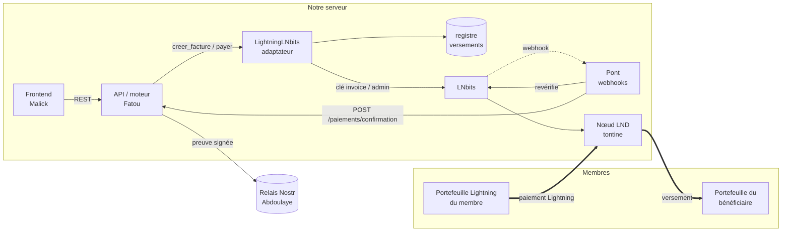
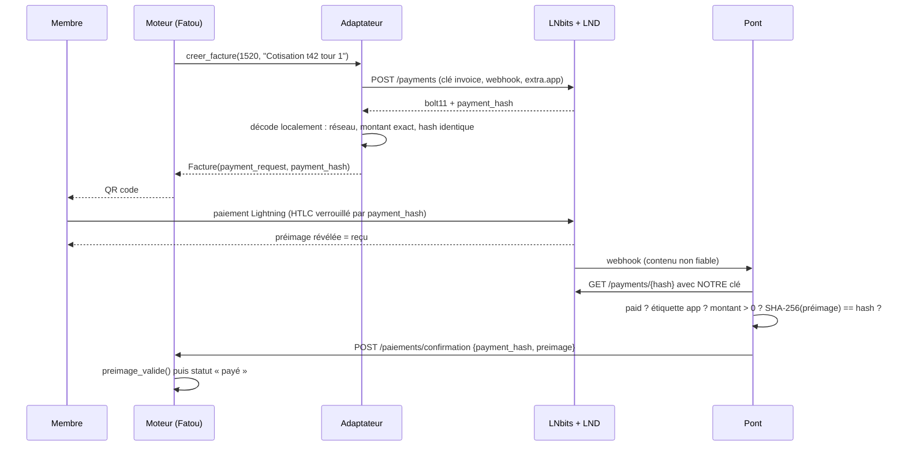
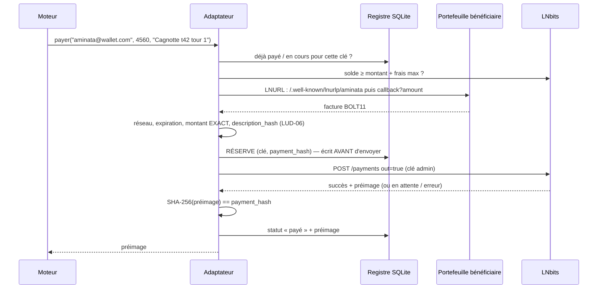

# Architecture de la couche Lightning

Ce document explique **comment l'argent circule**, **pourquoi chaque paiement est prouvé**, et **comment on empêche de perdre ou de verser deux fois** la cagnotte. C'est la base pour défendre le projet devant le jury.

---

## 1. Les concepts, en bref

### Bitcoin (couche 1)
Un registre public, répliqué sur des milliers de nœuds, où chaque transaction est signée par la clé privée de son propriétaire et confirmée par minage (≈ 10 min par bloc). Sûr, mais lent et coûteux pour des cotisations de quelques milliers de FCFA.

### Lightning (couche 2)
Deux nœuds bloquent des bitcoins dans une transaction commune on-chain : **un canal de paiement**. Ensuite, ils s'échangent des paiements **hors chaîne** en mettant à jour, à chaque paiement, la répartition du solde du canal (signée par les deux). Résultat : paiement en une seconde, pour une fraction de sat. Les canaux s'enchaînent, ce qui permet de payer n'importe qui sur le réseau par **routage**.

### La facture et la preuve de paiement (au cœur du projet)
1. Le destinataire tire un secret aléatoire de 32 octets : la **préimage**.
2. Il publie une **facture BOLT11** qui contient `payment_hash = SHA-256(préimage)`, le montant, une date d'expiration, le tout **signé** par la clé de son nœud.
3. Le payeur envoie un paiement **verrouillé par ce hash** (HTLC) : chaque nœud du chemin ne peut récupérer les fonds qu'en présentant la préimage.
4. Pour encaisser, le destinataire révèle la préimage, qui remonte le chemin jusqu'au payeur.

**Conséquence :** pour le **payeur**, une préimage `p` telle que `SHA-256(p) == payment_hash` est une **preuve cryptographique** que sa facture a été payée. Il ne peut l'obtenir qu'en payant : impossible de la deviner (2²⁵⁶ possibilités) ou de la tirer du hash (SHA-256 n'est pas inversible). C'est cette paire `(payment_hash, préimage)` que le registre Nostr publie : chaque membre peut la comparer au reçu affiché par son portefeuille.

> ⚠️ **Piège évité.** Pour le **destinataire**, la préimage ne prouve rien : c'est lui qui l'a tirée au hasard. Dans notre cas, LNbits génère et stocke la préimage de chaque facture de cotisation **dès sa création** (vérifié dans son code source). Notre serveur la connaît donc avant tout paiement. Pour savoir si une cotisation a été reçue, la seule source de vérité est l'état du paiement chez LNbits / LND. C'est ce que vérifie `cotisation_recue()`, et le moteur l'exige avant de confirmer (voir INTEGRATION.md n° 0).

### Préfixes de réseau
| Préfixe facture | Réseau | Usage ici |
|---|---|---|
| `lnbc…` | mainnet (vrais sats) | démo devant le jury, petites sommes |
| `lntb…` / `lntbs…` | testnet / signet | non utilisés |
| `lnbcrt…` | regtest (chaîne privée locale) | développement et tests |

Le module **refuse toute facture d'un autre réseau** que celui configuré : impossible de payer par erreur une facture mainnet avec la config de test, ou l'inverse.

---

## 2. Vue d'ensemble

| Composant | Rôle | Responsable |
|---|---|---|
| `LightningLNbits` | implémente l'interface `Lightning` du moteur (`creer_facture`, `payer`) | Alassane |
| Registre des versements (SQLite) | journal d'intention : jamais deux versements pour un même tour | Alassane |
| Pont | webhook LNbits → revérification → `/paiements/confirmation` | Alassane |
| LNbits | API HTTP, clés séparées lecture/dépense, webhooks | Alassane (config) |
| LND (regtest) / phoenixd (mainnet) | le nœud Lightning qui détient réellement les canaux | Alassane (config) |

---

## 3. Flux d'une cotisation

**Pourquoi un pont ?** Vérifié dans le code source de LNbits :
- le webhook envoie l'objet `Payment` complet, **encodé deux fois en JSON**, et non `{payment_hash, preimage}` ;
- LNbits **refuse par défaut** les webhooks vers une IP privée (réseau Docker) ;
- un webhook peut se perdre (backend arrêté, redémarrage) : LNbits ne réessaie pas.

Le pont résout ces trois points : il revérifie tout à la source et livre « au moins une fois », avec une boucle de réconciliation toutes les 10 s et des délais croissants (2, 4, 8 … 300 s) si le backend est indisponible.

---

## 4. Flux d'un versement (le moment risqué)

### Les garde-fous, et ce qu'ils empêchent

| Garde-fou | Attaque ou panne évitée |
|---|---|
| Clé d'idempotence `SHA-256(adresse, montant, description)` | le moteur appelle `payer()` deux fois (double clic, relance, retry HTTP) → **un seul paiement** |
| Journal d'intention écrit **avant** l'envoi | crash du serveur pendant l'envoi → au redémarrage on vérifie au lieu de repayer |
| Mise à jour du registre conditionnée au `payment_hash` | le suivi périmé d'une ancienne tentative ne peut plus écraser la tentative en vol (trouvé en relecture) |
| Relance = **même facture** tant que LNbits ne l'a jamais vue | si une requête « fantôme » aboutissait, LND refuserait de payer deux fois le même hash |
| Refus de payer une facture émise par la tontine elle-même | « paiement interne » : rien ne sort mais une préimage valide serait renvoyée |
| Transaction SQLite `BEGIN IMMEDIATE` + verrou | 8 requêtes simultanées → **1 seul paiement** (testé) |
| « Inconnu » ≠ « échoué » tant que la réservation a moins de 120 s | condition de course trouvée par nos tests : un 2ᵉ fil concluait à tort à l'échec et repayait |
| Erreur réseau après l'envoi → on interroge LNbits | timeout alors que le paiement est parti → pas de 2ᵉ paiement |
| Décodage **local** de la facture (signature, bech32) | LNbits ou le portefeuille renvoie une facture d'un autre montant |
| Montant **exact** exigé, factures sans montant refusées | un portefeuille malveillant demande plus que prévu |
| Vérification du réseau (`lnbcrt` / `lnbc`) | payer une facture mainnet en test, ou l'inverse |
| `description_hash == SHA-256(metadata)` (LUD-06) | facture substituée entre la demande LNURL et le paiement |
| Plafond par versement (`LIGHTNING_MAX_VERSEMENT_SATS`) | bug ou compromission : les pertes restent bornées |
| Contrôle du solde + marge de frais | paiement partiel ou bloqué |
| Protection SSRF (HTTPS + IP publique, pas de redirection) | `x@169.254.169.254` ferait appeler les services internes du serveur |

---

## 5. Modèle de menaces

| Menace | Réponse | Limite restante (à dire au jury) |
|---|---|---|
| **Faux webhook** envoyé au pont | jeton secret dans l'URL **et** revérification complète auprès de LNbits | aucune |
| **Fausse confirmation** postée à `/paiements/confirmation` avec la préimage d'une facture **impayée** (lisible avec la clé « invoice ») | jeton `X-Jeton-Pont` exigé par la route **et** `cotisation_recue()` : le moteur demande à LNbits si l'argent est arrivé | aucune, une fois les corrections n° 0 appliquées dans le backend. Faille trouvée en relecture, démontrée puis corrigée par des tests |
| **Webhook refusé** par LNbits | `LNBITS_CALLBACK_URL_RULES` autorise `http://pont:8000` (par défaut, LNbits exige un domaine avec un point et répond 400 à la création de la facture) | aucune |
| **Vol de la clé admin** | jamais côté frontend ni dans Git ; plafond par versement | quelqu'un qui a la clé peut vider le portefeuille jusqu'au plafond, une fois par tour |
| **Garde des fonds** : le service détient la cagnotte | petites sommes, versement dès que le tour est complet | c'est un modèle **custodial** pendant le tour. Évolution prévue : les **hold invoices** (séquestre), voir § 6 |
| **Membre qui ne paie pas** | statut visible de tous (moteur) | Lightning ne permet pas de prélever de force |
| **Volatilité du BTC** | montant fixé en FCFA, converti au moment de la facture (moteur) | le bénéficiaire reçoit des sats, et leur valeur peut bouger après le versement |
| **Confidentialité** | identifiants anonymes sur Nostr (Abdoulaye) | le nœud du destinataire connaît le montant |
| **Rebinding DNS** contre le contrôle SSRF | connexion **épinglée** sur l'IP vérifiée (en-tête Host et SNI séparés), sans redirection, sans proxy, taille de réponse limitée | aucune connue |
| **Registre local perdu** (autre dossier, conteneur recréé) | chemin absolu par défaut (`~/.tontine_lightning/`, obligatoire en mainnet) **et** LNbits consulté (`extra.versement`) avant tout paiement | aucune connue |

---

## 6. Évolution : séquestre par hold invoices

LNbits sait créer des **hold invoices** (vérifié : `extra.hold`, `POST /payments/settle`, `POST /payments/cancel`). Le membre paie, mais **les fonds restent bloqués dans les HTLC** au lieu d'être encaissés :
- si tous les membres ont payé → on encaisse tout (`settle`) puis on verse au bénéficiaire ;
- si le tour échoue → on **annule** (`cancel`) : chaque membre est remboursé automatiquement, sans intervention.

**Avantage :** le service ne détient jamais des fonds qu'il ne peut pas rendre. **Contrainte :** des HTLC bloqués immobilisent de la liquidité sur tout le chemin de routage. C'est adapté à des tours de quelques heures (la démo), pas à des tours d'une semaine. C'est une étape après la priorité 1, comme décidé en équipe.

---

## 7. Choix techniques

| Choix | Pourquoi |
|---|---|
| **LNbits** devant LND | clés séparées *invoice* (lecture) et *admin* (dépense), webhooks, multi-portefeuilles, compatible LND, phoenixd, etc. |
| **Regtest** dans Docker | vrai Bitcoin et vrai Lightning, reproductible, gratuit, sans dépendre d'un service tiers |
| **phoenixd** pour le mainnet | nœud auto-géré qui gère seul sa liquidité entrante : idéal pour une démo |
| **SQLite** pour le registre | transactions ACID et journal WAL, zéro infrastructure ; suffit pour un seul serveur |
| **Décodage local** avec `bolt11` | ne pas faire confiance à un tiers pour lire ce qu'on va payer |
| **Pont séparé** du backend | le backend de Fatou reste inchangé ; on peut redémarrer chaque service séparément |
