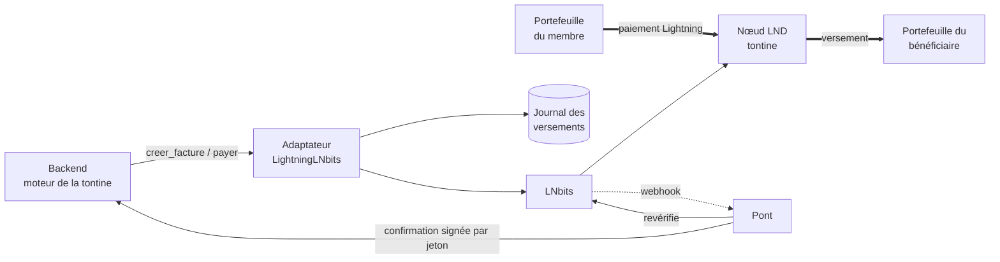

# ⚡ Tontine Lightning — infrastructure de paiement Bitcoin Lightning


Couche Lightning d'une **application de tontine numérique** : les cotisations et la cagnotte circulent en Bitcoin Lightning, et chaque paiement laisse une preuve cryptographique vérifiable par tous les membres.

Projet d'équipe réalisé pour le **Hackathon #4 des Dakar Bitcoin Days 2026** (porté par Btrust). Ce dépôt contient **ma partie : l'infrastructure Lightning et la sécurité des fonds**.

> 📐 Concepts Bitcoin/Lightning, flux et modèle de menaces : **[ARCHITECTURE.md](ARCHITECTURE.md)**
> 🔌 Intégration avec le moteur de la tontine et revue de sécurité croisée : **[INTEGRATION.md](INTEGRATION.md)**

---

## Le problème

Une tontine repose sur la confiance envers une seule personne qui tient la caisse et le cahier des cotisations. Cela crée des retards, des disputes sur qui a payé, et un risque de perte. L'application garde le fonctionnement habituel de la tontine, mais rend **chaque paiement visible et prouvable**.

## Ce que j'ai construit

| Composant | Rôle |
|---|---|
| **Adaptateur LNbits** (`tontine_lightning/`) | Crée les factures de cotisation, vérifie les paiements reçus, verse la cagnotte au bénéficiaire. Implémente l'interface `Lightning` du moteur de la tontine. |
| **Pont webhooks** (`tontine_lightning/pont/`) | Service FastAPI : reçoit les notifications de LNbits, **revérifie chaque paiement à la source**, puis le confirme au backend. Livraison « au moins une fois » avec rattrapage automatique. |
| **Réseau Lightning local** (`docker-compose.yml`) | Vrai réseau Bitcoin + Lightning en regtest : bitcoind, 2 nœuds LND, LNbits, pont. Initialisé en une commande. |
| **Outillage** (`scripts/`) | Initialisation du réseau, simulation des membres, vérification et démo de bout en bout. |
| **Tests** (`tests/`) | 74 tests avec de vraies factures BOLT11 signées, dont 7 qui chargent le vrai backend de l'équipe. |

## Résultat validé

Un tour complet de tontine, joué sur le vrai réseau Lightning local et l'API du backend de l'équipe (`scripts/demo_tour.py`) :

```
==> 4. Chaque membre scanne son QR code et paie en Lightning
    [OK] Awa a payé 11202 sats
    [OK] Bineta a payé 11202 sats
    [OK] Coumba a payé 11202 sats
==> 5. Le pont confirme chaque paiement au backend, qui verse la cagnotte
    … cotisations : 3/3 payées, versement : fait
    [OK] Awa a reçu 33606 sats (preuve : préimage dc296db85a806147…)
Tour complet réussi : création, inscriptions, tirage, 3 paiements Lightning, confirmation par le pont, versement.
```

## Architecture



## Points d'ingénierie

**Sécurité des fonds**
- **Jamais deux versements pour un même tour** : journal d'intention écrit *avant* l'envoi (SQLite, transactions `BEGIN IMMEDIATE`), clé d'idempotence, et LNbits consulté comme seconde mémoire. Testé avec 8 appels simultanés, des pannes et des coupures réseau.
- **Une préimage ne prouve pas qu'on a été payé** : pour une facture entrante, c'est le serveur qui l'a générée. Seule la réception constatée par le nœud compte (`cotisation_recue()`). Faille trouvée en relecture de sécurité, démontrée par un test puis corrigée avec l'équipe.
- **Factures décodées localement** (signature, réseau, montant exact, expiration) avant tout paiement ; conformité LUD-06 (`description_hash`).
- **Protection SSRF** sur les adresses Lightning : HTTPS obligatoire, IP publique exigée, connexion épinglée sur l'IP vérifiée (anti DNS rebinding).
- Plafond par versement, contrôle du solde, clé de dépense jamais exposée, services en écoute sur `127.0.0.1` seulement.

**Fiabilité (systèmes répartis)**
- Reprise après panne : un versement interrompu est retrouvé et suivi, jamais repayé.
- Pont tolérant aux pannes du backend : délais croissants et réconciliation périodique.
- Une condition de course détectée par les tests (double paiement sur appels concurrents) a été corrigée et couverte par des tests de non-régression.

Le détail est dans [ARCHITECTURE.md](ARCHITECTURE.md).

## Démarrage rapide (regtest, ~5 min)

Prérequis : Docker Desktop lancé, Python ≥ 3.10.

```bash
python -m venv .venv
.venv\Scripts\activate             # Windows   (macOS/Linux : source .venv/bin/activate)
pip install -e ".[dev]"
pytest                             # tests unitaires, sans réseau

python scripts/regtest.py init     # conteneurs, minage, canaux, portefeuille LNbits, .env, pont
python scripts/regtest.py verifier # vraie cotisation + vrai versement sur le réseau local
```

`init` peut être relancé sans risque. Il écrit `.env` (ignoré par Git). Les ports se changent dans `.env` (`LNBITS_PORT`, `PONT_PORT`).

| Commande | Usage |
|---|---|
| `python scripts/demo_tour.py` | démo complète via l'API du backend (lancé en mode LNbits) |
| `python scripts/regtest.py payer <bolt11>` | un « membre » paie une facture |
| `python scripts/regtest.py soldes` | soldes des canaux et du portefeuille |
| `python scripts/regtest.py miner 6` | mine 6 blocs |
| `docker compose logs -f pont` | suivre les cotisations relayées |
| `docker compose down -v` | tout effacer et repartir de zéro |

En regtest, toute adresse **`nom@regtest.local`** est une adresse Lightning valide, servie par le pont.

## Brancher un backend

L'adaptateur implémente cette interface :

```python
class Lightning(Protocol):
    def creer_facture(self, montant_sats: int, description: str) -> Facture: ...
    def cotisation_recue(self, payment_hash: str) -> bool: ...
    def payer(self, adresse_lightning: str, montant_sats: int, description: str) -> str: ...
```

```python
from tontine_lightning import LightningLNbits
lightning = LightningLNbits.depuis_env(fabrique_facture=Facture)
lightning.reprendre_versements_en_cours()   # au démarrage
```

Dans le projet d'équipe, le backend s'installe avec `pip install -r backend/requirements-lightning.txt`, se lance avec `LIGHTNING_MODE=lnbits` et `LIGHTNING_ENV_FILE=../lightning/.env`, et refuse de démarrer sans le jeton du pont.

| Issue de `payer()` | Exception | Conduite à tenir |
|---|---|---|
| Succès | retourne la préimage | marquer versé, publier la preuve |
| Bloqué avant envoi | `VersementRefuse`, `AdresseLightningInvalide` | afficher l'erreur ; rien n'est parti |
| Envoyé, échoué | `VersementEchoue` | relancer |
| Issue inconnue | `VersementEnAttente` | ne pas marquer échoué ; rappeler `payer()` avec les mêmes arguments |

## Démo sur le vrai réseau (mainnet)

Prévue avec [phoenixd](https://phoenix.acinq.co/server) et de petites sommes (`docker-compose.mainnet.yml`, `.env.mainnet.example`, plafonds à 20 000 sats). Étape à venir.

## Structure

```
├── tontine_lightning/
│   ├── adaptateur.py      LightningLNbits (interface du moteur)
│   ├── lnbits.py          client API LNbits
│   ├── factures.py        décodage local BOLT11
│   ├── lnurl.py           adresse Lightning -> facture, anti-SSRF, LUD-06
│   ├── registre.py        journal d'intention des versements (SQLite)
│   ├── crypto.py          vérification SHA-256(préimage) == payment_hash
│   ├── reglages.py        configuration et plafonds
│   ├── erreurs.py         exceptions
│   └── pont/              webhooks -> backend, annuaire regtest
├── scripts/               regtest.py, demo_tour.py
├── tests/
├── docker-compose.yml     docker-compose.mainnet.yml   Dockerfile   pyproject.toml
├── ARCHITECTURE.md        INTEGRATION.md
```

## Équipe

| Membre | Rôle |
|---|---|
| **Alassane Ndour** | Infrastructure Lightning, sécurité des fonds (ce dépôt) |
| Ndèye Fatou Sow | Moteur de la tontine, conversion FCFA → sats, API |
| Malick Fall | Interface, temps réel, déploiement |
| Abdoulaye Diouf | Registre Nostr, tests utilisateurs, vidéo de démo |
